## {.title-me}

::: {.me}
::: {.step}
[Hi, I'm Alireza Karduni]{.bigname}

[I teach and research data visualization, among other things]{.subname}
:::

:::

# [01]{.num}Storytelling with  [visualization??]{.accent} {.section-slide background-color="#1E2022"}

## Berries {.notitle}

::: {.r-stack}
{.frame height="560"}

:::

## 64 numbers {.notitle}

::: {.r-stack}

:::

[Global temperature, 1962–2025, °C above the 1951–1980 average. Data: [NASA GISTEMP v4](https://data.giss.nasa.gov/gistemp/)]{.source}

## Map {.notitle}

::: {.r-stack}

:::

[Data: [Our World in Data, CO₂ emissions per person (2024)](https://github.com/owid/co2-data)]{.source}

## Bars {.notitle}

[Data: [Our World in Data, CO₂ emissions per person (2024)](https://github.com/owid/co2-data)]{.source}

## Squares {.notitle}

[Data: [Our World in Data, CO₂ emissions per person (2024)](https://github.com/owid/co2-data)]{.source}

## Snake bars {.notitle}

[Data: [Our World in Data, cumulative CO₂ emissions](https://github.com/owid/co2-data)]{.source}

## Du Bois {.notitle}

::: {.center}
{.frame height="600"}
:::

## Visualization {.statement-list}

::: {.split .wide}
::: {.text style="font-size:0.95em"}
Taking "data" and somehow using visual elements so that we can take advantage of our vision to understand data.
:::

::: {style="font-size:1.25em; padding-top:.4em"}
::: {.fragment .fade-up}
Color
:::
::: {.fragment .fade-up}
Position
:::
::: {.fragment .fade-up}
Length
:::
::: {.fragment .fade-up}
Angle
:::
::: {.fragment .fade-up .muted}
From triangles to horses and flowers
:::
:::
:::

## Data is everywhere and we use it all the time



## {.statement}

Visualizations are everywhere

## They are in games we played last year

::: {.center}
{.frame height="540"}
:::

## They are in the difficult games we play today

::: {.center}
{.frame height="540"}
:::

## It's in the drama around games

::: {.center}
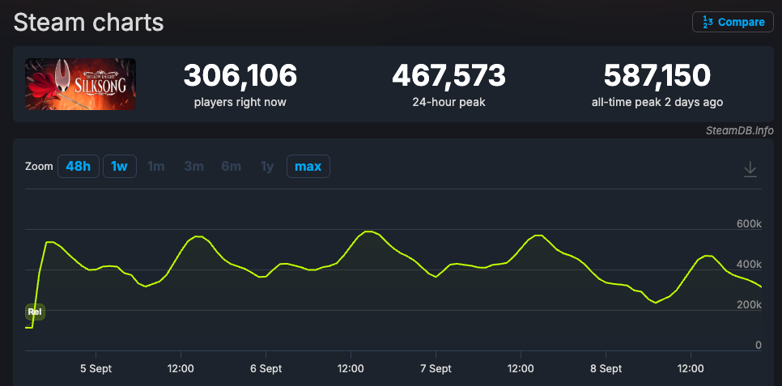{.frame height="520"}
:::

## {.notitle}

::: {.center}
{.frame width="1120"}

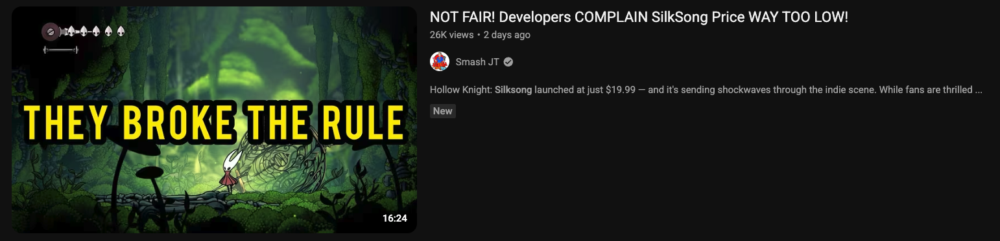{.frame .fragment width="1120"}
:::

## What is this visualization about?

::: {.center}
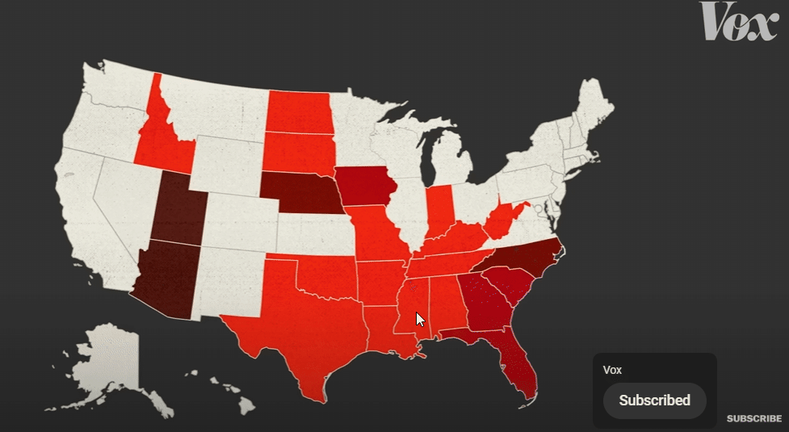{.frame height="530"}
:::

## It's in journalism and politics

::: {.center}
{.frame height="530"}
:::

## Our daily lives have been involved with visualizations

::: {.center}
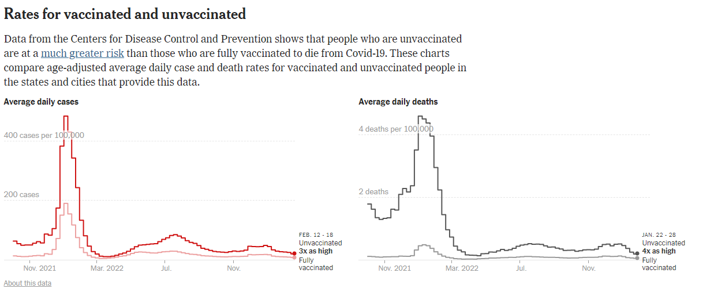{.frame width="1100"}
:::

## Patterns {.notitle}

::: {.r-stack style="padding-top:1em"}

::: {.layer .fragment}
{.frame height="560"}
:::

:::

## Visualizations help us navigate our spaces

::: {.img-row}
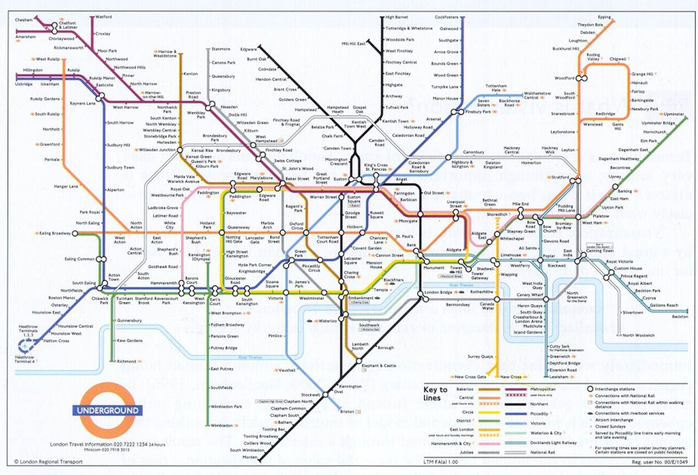{.frame height="400"}

{.frame .fragment height="400"}
:::

## {.notitle}

::: {.center}
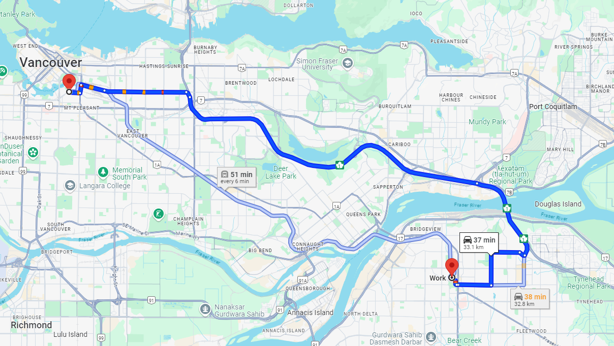{.frame height="640"}
:::

## We can make them into art forms

::: {.img-row}
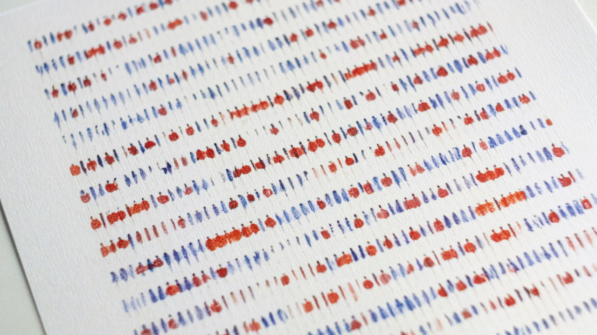{.frame height="440"}

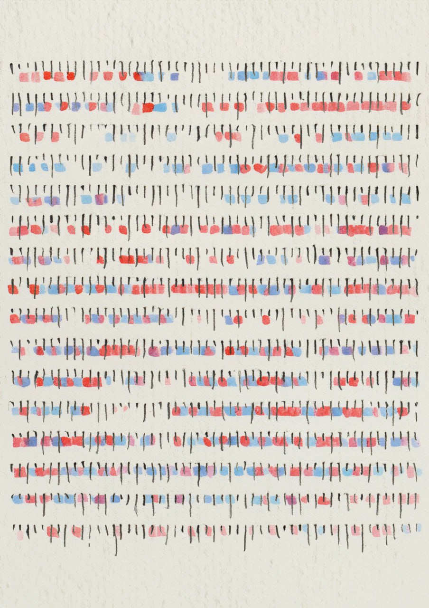{.frame .fragment height="440"}
:::

## Warming stripes {.notitle}

[Warming stripes, after Ed Hawkins. Data: [NASA GISTEMP v4](https://data.giss.nasa.gov/gistemp/)]{.source}

## {.notitle}

::: {.img-row}
{.frame height="520"}

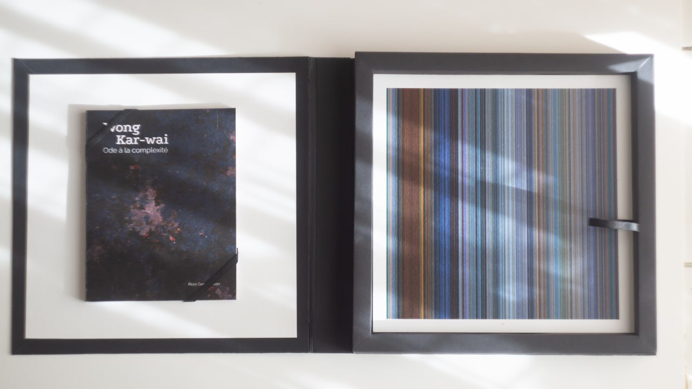{.frame .fragment height="520"}
:::

## We use it to turn big data into meaningful information

::: {.center}
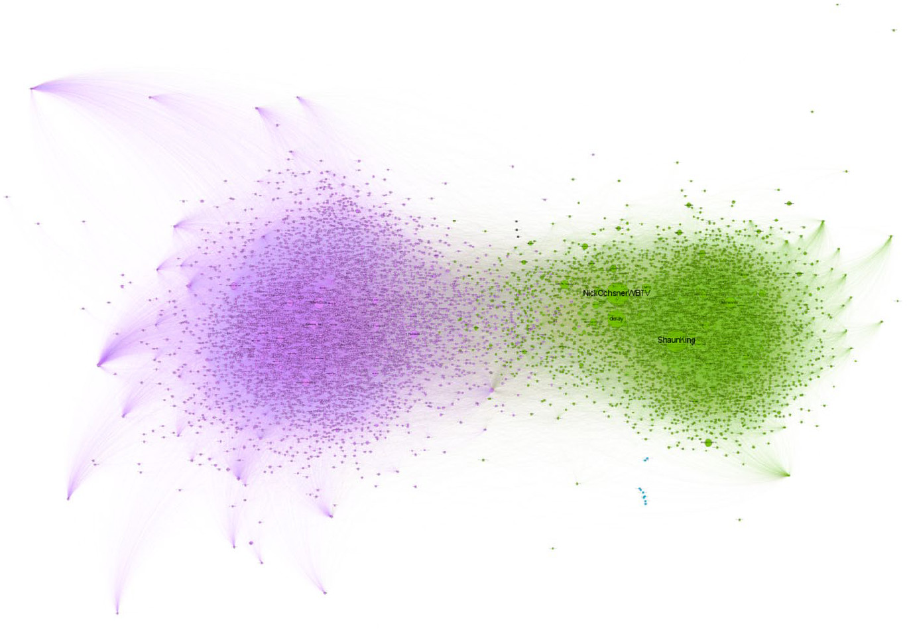{.frame height="470"}
:::

## And learn something about society

::: {.center}
{.frame height="470"}
:::

# [02]{.num}What [works?]{.accent} {.section-slide background-color="#1E2022"}

Learning from best practices from psychology and computer science

## Take a look {.notitle}

::: {.split}
::: {.text}
::: {.textstack}
::: {.step .fragment .fade-out data-fragment-index="1"}
[Take a look at this chart]{.h3}

What can we learn from this chart?
:::

::: {.fragment .fade-in-then-out data-fragment-index="1"}
[Take a look at this chart]{.h3}

Spend some time and read the description with the chart.
:::

::: {.fragment data-fragment-index="2"}
[Now this]{.h3}

It requires much less work to read the chart that is designed like this.
:::
:::
:::

::: {.r-stack}

:::
:::

[Inspired by: [nytimes.com, One Report, Diverging Perspectives (2012)](http://www.nytimes.com/interactive/2012/10/05/business/economy/one-report-diverging-perspectives.html). Data: [US Bureau of Labor Statistics, via FRED](https://fred.stlouisfed.org/series/UNRATE)]{.source}

## Five lessons

::: {.split .wide}
::: {.principles}
::: {.fragment}
Some visual encodings are noisier
:::
::: {.fragment}
Some illusions distort data
:::
::: {.fragment}
Global statistics are fast
:::
::: {.fragment}
Comparisons are slow
:::
::: {.fragment}
Guide viewers to the right comparisons
:::
:::

::: {.center}
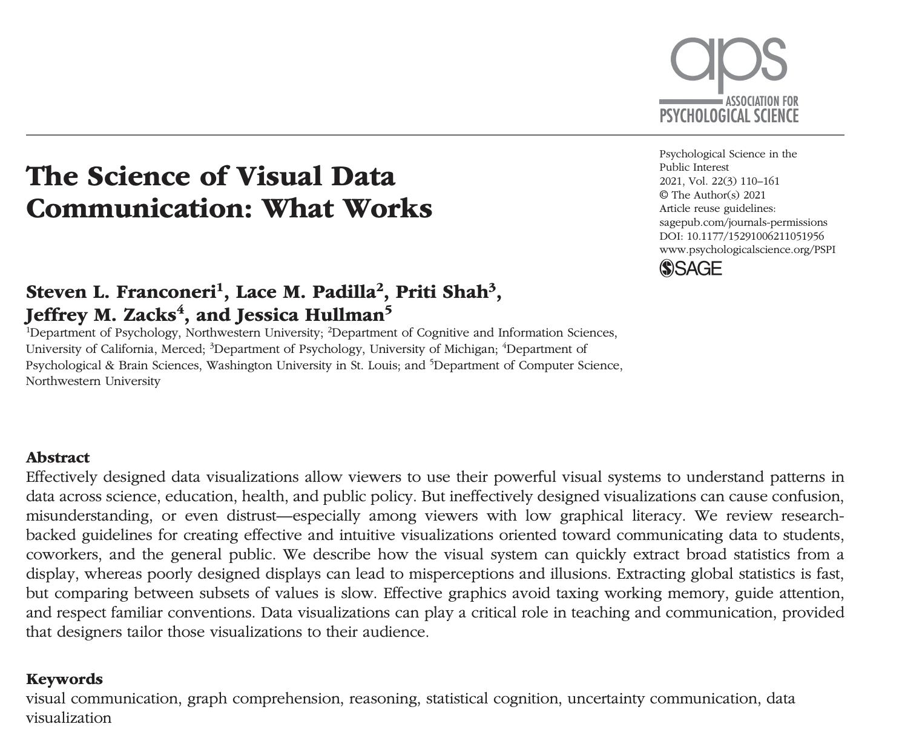{.frame height="380"}

[Franconeri, Padilla, Shah, Zacks & Hullman (2021). *The Science of Visual Data Communication: What Works.*]{.tiny}
:::
:::

## Encodings {.notitle}

[[01]{.n}Some visual encodings are noisier]{.lesson}

::: {.enc-cols}
::: {.col}
::: {.cell}
**Position**

:::

::: {.cell .fragment}
**Length**

:::

::: {.fragment .caption}
People are more precise in reading these.
:::
:::

::: {.col}
::: {.cell .fragment}
**Angle**

:::

::: {.cell .fragment}
**Intensity**

:::

::: {.fragment .caption}
People are less precise in reading these.
:::
:::
:::

## Non-zero axes {.notitle}

[[02]{.n}Some illusions distort data]{.lesson}

::: {.fig-text}
::: {.img-row style="gap:3em"}

:::

::: {.text}
Use caution with nonzero axes: viewers tend to overestimate differences… even when the nonzero base is marked.
:::
:::

## In the wild {.notitle}

[[02]{.n}Some illusions distort data]{.lesson}

::: {.img-row style="gap:2em; padding-top:.5em"}
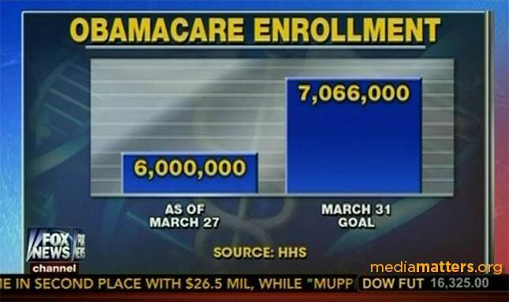{.frame width="560"}

::: {.r-stack .fragment}

:::
:::

## Stacked bars {.notitle}

[[02]{.n}Some illusions distort data]{.lesson}

::: {.fig-text}
::: {.r-stack}

:::

::: {.text}
::: {.textstack}
::: {.step .fragment .fade-out data-fragment-index="1"}
Stacked bar: bars on the baseline are position-coded = more precise perception.
:::

::: {.fragment data-fragment-index="1"}
[These]{.hot .strong} have the same value differences among them as the black bars, but the differences are only visible across the black bars.
:::
:::
:::
:::

## Lines {.notitle}

[[02]{.n}Some illusions distort data]{.lesson}

::: {.fig-text}
::: {.r-stack}

:::

::: {.text}
The difference is larger for the lighter segments compared with the darker ones, right?

::: {.fragment data-fragment-index="1"}
That is an illusion: [the differences are identical]{.hot .strong}.
:::
:::
:::

## Backgrounds {.notitle}

[[02]{.n}Some illusions distort data]{.lesson}

::: {.fig-text}
::: {.r-stack}

:::

::: {.text}
Intensity values can look different depending on their backgrounds.

::: {.fragment data-fragment-index="1"}
Do not plot intensities on intensities.
:::
:::
:::

## Dual axes {.notitle}

[[02]{.n}Some illusions distort data]{.lesson}

::: {.img-row style="gap:2.5em; padding-top:.4em"}
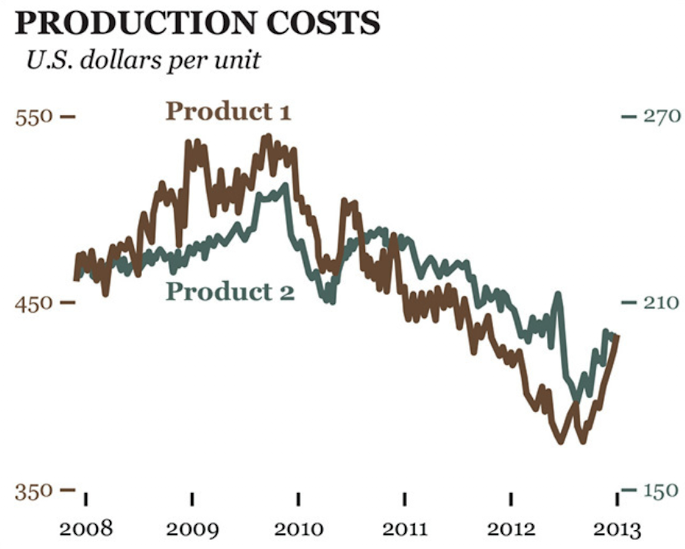{.frame height="470"}

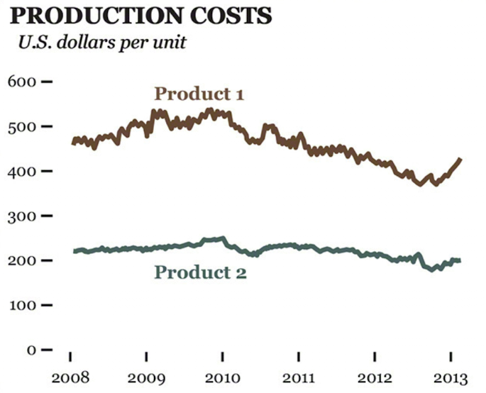{.frame .fragment height="470"}
:::

[Figures 2.4 and 2.5 from Alberto Cairo, *The Truthful Art* (2016).]{.source}

## Global statistics are fast {.notitle}

[[03]{.n}Global statistics are fast]{.lesson}

::: {.img-row style="gap:4em; align-items:flex-start; padding-top:1em"}
::: {.r-stack}

:::

::: {.r-stack .fragment}

:::
:::

## Comparisons {.notitle}

::: {.textstack}
::: {.step .fragment .fade-out data-fragment-index="3"}
[[04]{.n}Comparisons are slow]{.lesson}
:::

::: {.fragment data-fragment-index="3"}
[[05]{.n}So, guide viewers to the right comparisons]{.lesson}
:::
:::

::: {.fig-text}
::: {.r-stack}

:::

::: {.text}
::: {.textstack}
::: {.fragment .fade-out data-fragment-index="3"}
::: {.fragment data-fragment-index="1"}
Isolating pairs with "larger second values" is tough…
:::
:::

::: {.fragment .fade-in-then-out data-fragment-index="3"}
Tool: shortcut comparisons by adding direct depictions of the deltas, as below.
:::
:::
:::
:::

## Recap

::: {.split .wide}
::: {.principles}
::: {.step}
Some visual encodings are noisier to read
:::
::: {.step}
Some illusions distort data
:::
::: {.step}
Global statistics are fast
:::
::: {.step}
Comparisons are slow
:::
::: {.step}
Guide viewers to the right comparisons
:::
:::

::: {.center}
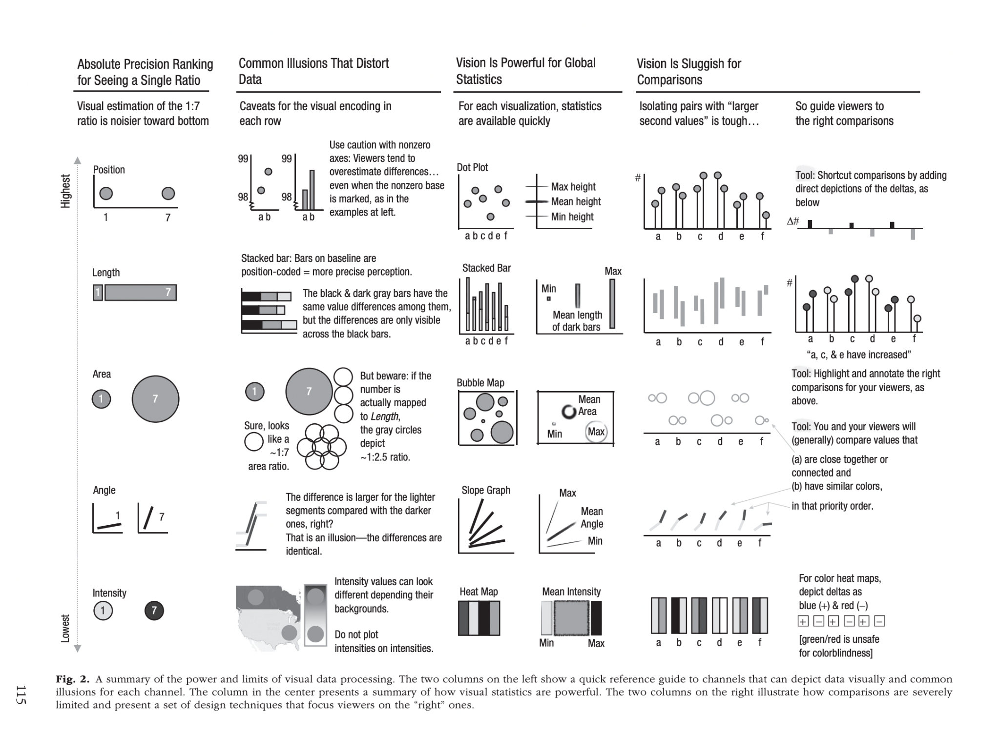{.frame height="520"}
:::
:::

## {.statement}

[1 · Simplify]{.fragment .fade-up} [2 · Structure]{.fragment .fade-up} [3 · Story]{.fragment .fade-up}

# [03]{.num}Let's [practice]{.accent} {.section-slide background-color="#1E2022"}

## Example 1 {.notitle}

::: {.split}
::: {.text}
::: {.textstack}
::: {.step .fragment .fade-out data-fragment-index="1"}
[Example 1]{.kicker}

[Let's transform this chart]{.h3}
:::

::: {.fragment .fade-in-then-out data-fragment-index="1"}
[Transform legends]{.h3}

Our eyes have to move back and forth between the legend and the chart to find the appropriate line.
:::

::: {.fragment .fade-in-then-out data-fragment-index="2"}
[Transform legends]{.h3}

So we can potentially remove the legend from the top.
:::

::: {.fragment .fade-in-then-out data-fragment-index="3"}
[Directly label lines]{.h3}

Now we can quickly find the different countries in the chart.
:::

::: {.fragment .fade-in-then-out data-fragment-index="4"}
[Annotate charts to tell a story.]{.h3}

We can use some of the text to directly annotate the chart.
:::

::: {.fragment .fade-in-then-out data-fragment-index="5"}
[Highlight an element of the chart]{.h3}

If an element in the chart is important, we can guide the reader's eyes with opacity and highlighting.
:::

::: {.fragment .fade-in-then-out data-fragment-index="6"}
[Use simpler charts if trends are less important]{.h3}

We can simplify the chart to only focus on important comparisons. This chart makes it easier to compare rates across countries.
:::

::: {.fragment data-fragment-index="7"}
[Different kinds of comparisons]{.h3}

This chart makes it easier to compare before and after values within each country.
:::
:::
:::

::: {.chart-col}
::: {.textstack .article-slot}
::: {.article .step .fragment .fade-out data-fragment-index="1"}
Since 1990, emissions in India and China have grown about five-fold. The UK has cut its emissions roughly in half, while Canada's are still almost 20% above their 1990 level.
:::

::: {.article .fragment .fade-in-then-out data-fragment-index="4"}
Since 1990, emissions in India and China have grown about five-fold. The UK has cut its emissions roughly in half, while Canada's are still almost 20% above their 1990 level.
:::
:::

::: {.r-stack}

:::
:::
:::

[Data: [Our World in Data, annual CO₂ emissions](https://github.com/owid/co2-data)]{.source}

## Example 2 {.notitle}

::: {.split}
::: {.text}
::: {.textstack}
::: {.step .fragment .fade-out data-fragment-index="1"}
[Example 2]{.kicker}

[A lot of information in here]{.h3}

We can make it easier to read this chart.
:::

::: {.fragment .fade-in-then-out data-fragment-index="1"}
[Lines are better understood as trends]{.h3}

Focus the eyes on the trend.
:::

::: {.fragment .fade-in-then-out data-fragment-index="2"}
[Remove redundant information]{.h3}

If the colors are secondary information, we can make them less salient. Because they might confuse users.
:::

::: {.fragment .fade-in-then-out data-fragment-index="3"}
[Dual axes are confusing]{.h3}

It's hard to distinguish the two without reading the text. Let's keep one axis for now.
:::

::: {.fragment .fade-in-then-out data-fragment-index="4"}
[Move the second chart]{.h3}

Our chart is simplified. But we still need the El Niño context.
:::

::: {.fragment .fade-in-then-out data-fragment-index="5"}
[Below the main chart]{.h3}

We can move the El Niño chart below.
:::

::: {.fragment data-fragment-index="6"}
[Annotations are very useful]{.h3}

The two charts share the same x-axis (time), and the same information is kept. We can add annotations to improve the message.
:::
:::
:::

::: {.r-stack}

:::
:::

[Data: [NASA GISTEMP v4](https://data.giss.nasa.gov/gistemp/) (°C above 1880–1900); [NOAA Oceanic Niño Index](https://psl.noaa.gov/data/correlation/oni.data)]{.source}

## Example 3 {.notitle}

::: {.split .wide}
::: {.text}
::: {.textstack}
::: {.step .fragment .fade-out data-fragment-index="1"}
[Example 3]{.kicker}

[It's hard to calculate differences]{.h3}

It seems like the light and dark bars are for two different points in time.
:::

::: {.fragment .fade-in-then-out data-fragment-index="1"}
[Derive the proper information for the audience]{.h3}

We can visualize the deltas to help with comparing the differences between these values.
:::

::: {.fragment .fade-in-then-out data-fragment-index="2"}
[The deltas look like this]{.h3}

We can visualize the deltas to help with comparing the differences between these values.
:::

::: {.fragment .fade-in-then-out data-fragment-index="3"}
[Grouped bar → simple bar]{.h3}

We can visualize the deltas to help with comparing the differences between these values.
:::

::: {.fragment data-fragment-index="4"}
[Color code groups]{.h3}

We can differentiate between positive and negative rates using color.
:::
:::
:::

::: {.r-stack}

:::
:::

[Data: [Our World in Data, CO₂ emissions per person](https://github.com/owid/co2-data)]{.source}

## Example 4 {.notitle}

::: {.split}
::: {.text}
::: {.textstack}
::: {.step .fragment .fade-out data-fragment-index="1"}
[Example 4]{.kicker}

[Let's transform this chart]{.h3}
:::

::: {.fragment data-fragment-index="1"}
[Reorganize the data]{.h3}
:::
:::
:::

:::

[Figures 5.15 and 5.16 from Alberto Cairo, *The Truthful Art* (2016). Values read from the figures.]{.source}

# [04]{.num}How we design [changes the story]{.accent} {.section-slide background-color="#1E2022"}

## Health plan {.notitle}

::: {.img-row style="gap:2em; padding-top:1em"}
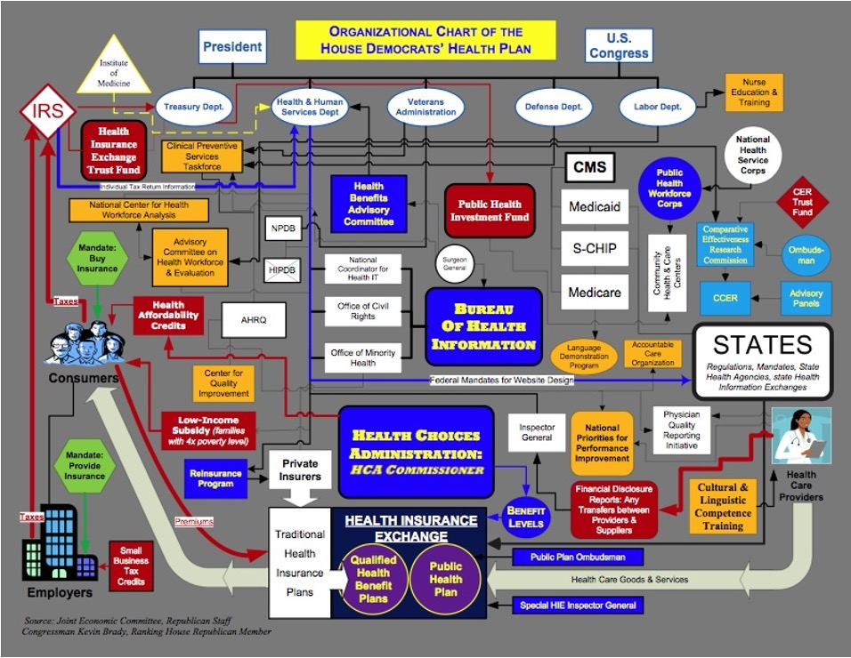{.frame height="540"}

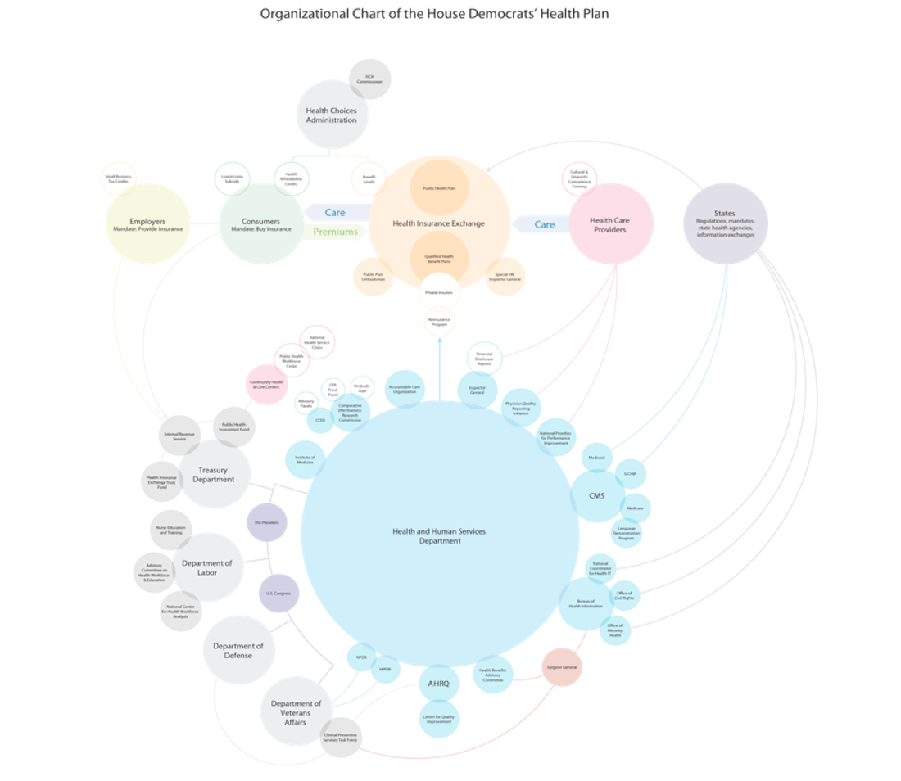{.frame .fragment height="540"}
:::

[Left: Joint Economic Committee, Republican staff (Rep. Kevin Brady), 2009, as discussed on the [Cato blog](https://www.cato.org/blog/jecgop-chart-house-democrats-health-plan). Right: a redesign of the same chart, 2009.]{.source}

## Same report, two stories {.notitle}

::: {.img-row style="gap:3em; align-items:flex-start; padding-top:1.5em"}
::: {.party}
[How a **Republican** might see it]{.party-label .hot}

:::

::: {.party .fragment}
[How a **Democrat** might see it]{.party-label .cool}

:::
:::

[After: Bostock, Carter, Cox & Quealy, [One Report, Diverging Perspectives](https://www.nytimes.com/interactive/2012/10/05/business/economy/one-report-diverging-perspectives.html), The New York Times, Oct 5, 2012. Data: [US Bureau of Labor Statistics, via FRED](https://fred.stlouisfed.org/series/UNRATE)]{.source}

## Immigration and housing {.notitle}

::: {.r-stack style="padding-top:1em"}

:::

[Values traced from the original charts. Sources: [American Community Survey (ACS), U.S. Census Bureau](https://www.census.gov/programs-surveys/acs); [Zillow Home Value Index (ZHVI)](https://www.zillow.com/research/data/)]{.source}

## These Graphs Prove That Canada's Housing Crisis Is Driven By Immigration

::: {.center}
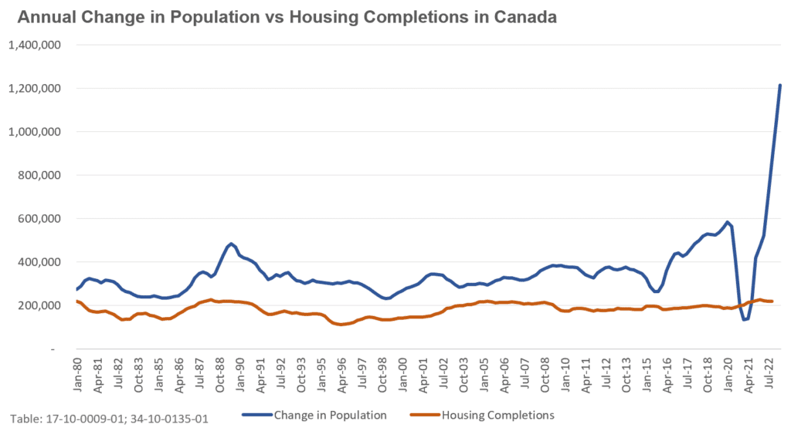{.frame height="500"}
:::

[[reddit.com/r/canadian](https://www.reddit.com/r/canadian/comments/1fwagm5/these_graphs_prove_that_canadas_housing_crisis_is/)]{.source}

## Tax cuts {.notitle}

::: {.img-row style="gap:3em; padding-top:2em"}
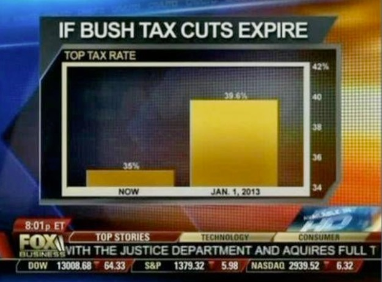{.frame height="440"}

::: {.fragment}

:::
:::

## Gun deaths {.notitle}

::: {.img-row style="gap:2.5em; padding-top:1em"}
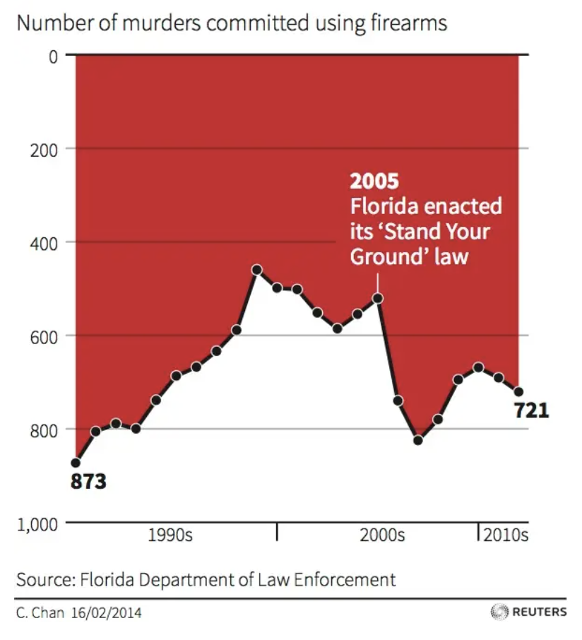{.frame height="560"}

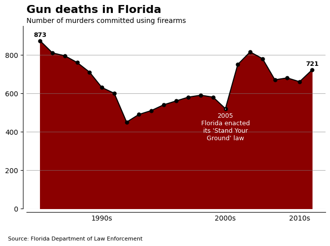{.frame .fragment height="430"}
:::

[Left: Reuters (C. Chan, 2014). Data: Florida Department of Law Enforcement.]{.source}

## Vaccines kill {.notitle}

::: {.center}
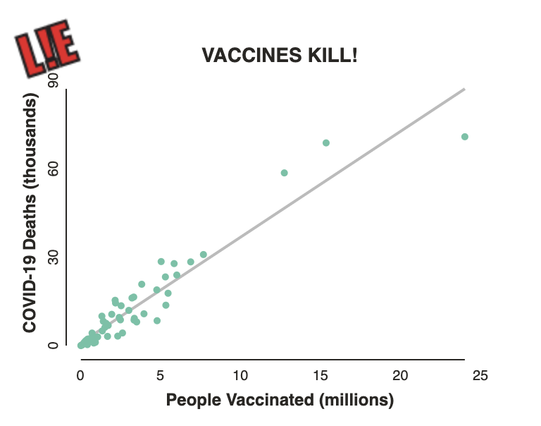{.frame height="600"}
:::

## Vaccines save {.notitle}

::: {.split .wide}
::: {.text style="font-size:1em; padding-top:2em"}
The count of just about anything correlates with the number of people in the region

How you choose your data is part of the storytelling
:::

::: {.center}
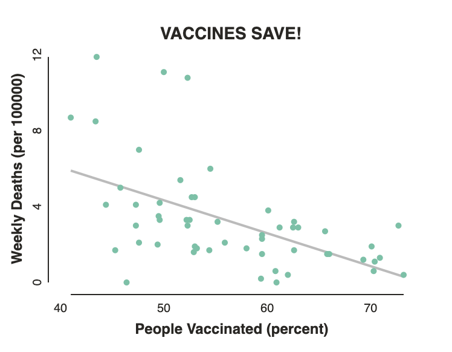{.frame height="580"}
:::
:::

## There is an art to storytelling with visualizations



[Hans Rosling's 200 Countries, 200 Years, 4 Minutes. *The Joy of Stats*, BBC (2010).]{.source}

## Ahvaz and the Karun {.notitle background-iframe="story/index.html" background-interactive="true"}

# Thank you {.section-slide background-color="#1E2022"}
